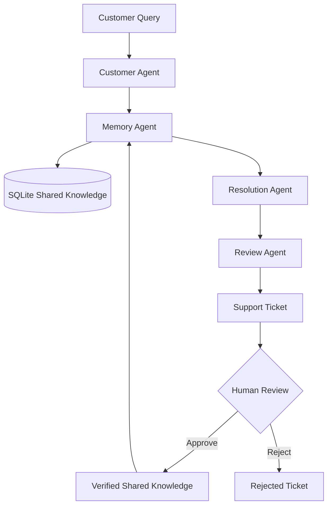

# 🤖 SupportMind AI
### Intelligent Multi-Agent Customer Support | Shared Memory | Human-in-the-Loop Review

<p align="center">
  An AI-powered customer support platform that helps support systems learn from previous resolutions, reduce repetitive work, and deliver more consistent responses.
</p>

<p align="center">
  
  
  
  
  
</p>

<p align="center">
  <a href="https://youtu.be/R-caZrOiK9U">Watch Project Demo</a> ·
  <a href="https://github.com/arish096/SupportMind-AI">GitHub Repository</a>
</p>

---

## Overview

SupportMind AI is a multi-agent customer support system designed to address a common operational challenge: **solving the same customer problems repeatedly without effectively reusing previous knowledge.**

Traditional support workflows often require agents to investigate similar issues from scratch. This can increase resolution time, duplicate effort, and create inconsistent customer experiences.

SupportMind AI introduces a coordinated AI-agent workflow with shared knowledge storage and human-supervised resolution approval.

Instead of treating every ticket as an entirely new problem, the system can search previously approved solutions and use relevant knowledge when generating a new response.

## The Problem

Customer support teams frequently face:

- Repeated customer issues that require similar investigation.
- Previous resolutions that are difficult to discover and reuse.
- Inconsistent responses across different support interactions.
- Limited visibility into repeated tickets and resolution performance.
- The need for human oversight before turning AI-generated solutions into trusted knowledge.

## The Solution

SupportMind AI uses four specialized AI agents working together through a coordinated workflow.

### Multi-Agent Architecture

| Agent | Responsibility |
|---|---|
| Customer Agent | Understands customer queries and identifies the underlying issue. |
| Memory Agent | Searches customer history and previously approved shared knowledge. |
| Resolution Agent | Generates practical resolutions using relevant available context. |
| Review Agent | Evaluates proposed responses for accuracy, completeness, safety, clarity, and professionalism. |

### Workflow

1. A customer submits a support request.
2. The Customer Agent analyzes the query.
3. The Memory Agent searches customer history and shared verified knowledge.
4. The Resolution Agent proposes a solution or requests missing information.
5. The Review Agent evaluates the proposed response.
6. A support ticket is created with a pending-review status.
7. A human reviewer approves or rejects the proposed resolution.
8. Approved solutions are stored in shared knowledge for future retrieval.



## Key Features

### 1. Multi-Agent AI Workflow
Four specialized agents collaborate to analyze, retrieve knowledge, generate resolutions, and review responses.

### 2. Shared Knowledge Memory
Previously approved support resolutions are stored in a persistent SQLite database and made available for future retrieval.

### 3. Customer History
The system maintains customer-specific support history to provide additional context during issue resolution.

### 4. Human-in-the-Loop Review
Human reviewers can approve or reject AI-generated resolutions before they become trusted shared knowledge.

### 5. Ticket Management
Support interactions are recorded as tickets with review statuses and customer information.

### 6. Repeat-Issue Tracking
The analytics layer tracks repeated issues and provides visibility into support activity.

### 7. Performance Analytics
The dashboard displays ticket statistics, review activity, response-time information, and estimated token usage.

### 8. Interactive Dashboard
A React-based interface provides access to the support chat, ticket management, overview, and analytics sections.

## Technology Stack

| Category | Technologies |
|---|---|
| Backend | Python, FastAPI |
| Agent Framework | Google Agent Development Kit (ADK) |
| LLM Integration | LiteLLM, OpenRouter |
| Frontend | React, JavaScript, Vite |
| Styling | CSS |
| Database | SQLite |
| API | REST API |

## Project Structure

```text
SupportMind-AI/
│
├── backend/
│   ├── support_agents/
│   │   ├── customer_agent.py
│   │   ├── memory_agent.py
│   │   ├── resolution_agent.py
│   │   ├── review_agent.py
│   │   ├── coordinator_agent.py
│   │   └── memory_store.py
│   │
│   ├── main.py
│   ├── requirements.txt
│   └── test_*.py
│
├── frontend/
│   ├── public/
│   ├── src/
│   │   ├── assets/
│   │   ├── App.jsx
│   │   ├── App.css
│   │   ├── index.css
│   │   └── main.jsx
│   ├── package.json
│   └── vite.config.js
│
└── .gitignore
```

## Getting Started

### Prerequisites

- Python 3.10+
- Node.js and npm
- An OpenRouter API key

### 1. Clone the Repository

```bash
git clone https://github.com/arish096/SupportMind-AI.git
cd SupportMind-AI
```

### 2. Backend Setup

```bash
cd backend
python -m venv .venv
```

Activate the virtual environment.

**Windows PowerShell:**

```powershell
.\.venv\Scripts\Activate.ps1
```

Install dependencies:

```bash
pip install -r requirements.txt
```

Create a `.env` file inside the `backend` folder:

```env
OPENROUTER_API_KEY=your_openrouter_api_key
```

Start the backend:

```bash
uvicorn main:app --reload
```

Backend runs at:

`http://127.0.0.1:8000`

API documentation:

`http://127.0.0.1:8000/docs`

### 3. Frontend Setup

Open a second terminal:

```bash
cd frontend
npm install
npm run dev
```

Frontend runs at:

`http://localhost:5173`

### 4. Try the Application

1. Open the frontend in your browser.
2. Submit a customer support query.
3. View the AI-generated response.
4. Open the Tickets section.
5. Approve or reject a pending resolution.
6. Explore the Overview and Analytics sections.

**Security:** Never commit `.env` files, API keys, database files, or other sensitive credentials to version control.

## API Endpoints

| Method | Endpoint | Purpose |
|---|---|---|
| GET | `/` | API welcome and status |
| GET | `/health` | Backend health check |
| POST | `/chat` | Submit a customer support query |
| GET | `/tickets` | Retrieve support tickets |
| POST | `/tickets/{ticket_id}/review` | Approve or reject a ticket |
| GET | `/analytics` | Retrieve performance analytics |

## Testing and Validation

The application has been tested with customer support scenarios, including payment-deducted-but-order-pending queries.

Tested workflows include:

- Multi-agent support request processing.
- Customer history and shared knowledge retrieval.
- AI-generated resolution review.
- Support ticket creation.
- Human approval and rejection.
- Approved solution storage.
- Repeat-issue tracking.
- Analytics API and dashboard integration.

## Engineering Considerations

SupportMind AI is an evolving prototype. Its current implementation uses SQLite-based persistent storage and basic lexical matching for shared knowledge retrieval. Repeat-issue detection uses a simplified matching approach, while token usage in analytics is estimated rather than taken from actual provider billing records.

The analytics dashboard also includes an illustrative weekly chart rather than a fully database-derived historical time series.

These are opportunities for future engineering improvements.

## Future Roadmap

- Semantic search using vector embeddings.
- More robust duplicate and similar-issue detection.
- Advanced performance and cost analytics using provider usage data.
- Expanded human review and knowledge-management workflows.
- Additional integrations with customer support platforms.
- Production-ready deployment, authentication, and monitoring.

## Project Demo

Watch the complete demonstration:

**[SupportMind AI – Project Demo](https://youtu.be/R-caZrOiK9U)**

---

## 👨‍💻 Author

**Arish Islam**

*Student Developer | Web Development | AI & Multi-Agent Systems*

<p align="left">
  <a href="https://github.com/arish096">
    
  </a>
  <a href="https://leetcode.com/u/Arish_Islam/">
    
  </a>
  <a href="https://hackerearth.com/@arishislam096/">
    
  </a>
  <a href="mailto:arishislam096@gmail.com">
    
  </a>
</p>

**Project:** [SupportMind AI](https://github.com/arish096/SupportMind-AI)

---

## ⭐ Support

If you find this project interesting or useful, consider giving the repository a ⭐ on GitHub.

<p align="left">
  <a href="https://github.com/arish096/SupportMind-AI">
    
  </a>
  <a href="https://github.com/arish096/SupportMind-AI/fork">
    
  </a>
</p>

---

<p align="center">
  <i>Building practical AI solutions through experimentation, creativity, and continuous learning.</i>
</p>

<p align="center">
  
</p>
