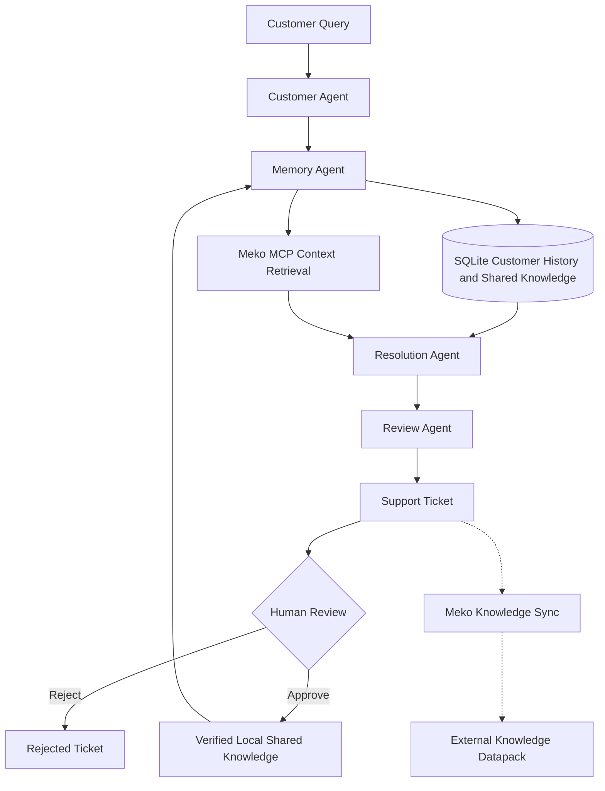

# 🤖 SupportMind AI

### Agentic Customer Support | Never Solve It Twice | Multi-Agent AI | Shared Memory | Human-in-the-Loop Review

<p align="center">
  An agentic AI-powered customer support platform that coordinates specialized AI agents, retrieves previous customer-support knowledge, and improves resolution consistency through shared memory and human-supervised review.
</p>

<p align="center">
  
  
  
  
  
  
</p>

<p align="center">
  <a href="https://youtu.be/R-caZrOiK9U">Watch Project Demo</a> ·
  <a href="https://github.com/arish096/SupportMind-AI">GitHub Repository</a>
</p>

---

## Overview

SupportMind AI is an agentic, multi-agent customer support platform built around a simple principle:

**Never Solve It Twice.**

Customer support teams repeatedly encounter similar issues, even when useful resolutions already exist in previous tickets or knowledge repositories. SupportMind AI addresses this problem by coordinating specialized AI agents that analyze requests, retrieve relevant context, generate resolutions, and review proposed responses.

The platform combines:

- Multi-agent orchestration using Google Agent Development Kit (ADK).
- Persistent customer history and shared knowledge using SQLite.
- External knowledge retrieval through the Model Context Protocol (MCP) and Meko integration.
- Human-in-the-loop review before resolutions become trusted knowledge.
- A React dashboard for support operations and analytics.

The goal is to move beyond isolated AI-generated replies toward a support system that can reuse context and continuously improve its knowledge base.

## The Problem

Customer support teams frequently face:

- Repeated customer issues that require similar investigation.
- Previous resolutions that are difficult to discover and reuse.
- Fragmented knowledge across customer records and support systems.
- Inconsistent responses across different support interactions.
- Limited visibility into repeated tickets and resolution performance.
- The need for human oversight before AI-generated solutions become trusted knowledge.

## The Solution

SupportMind AI uses four specialized AI agents working together through a coordinated workflow, supported by persistent shared memory and optional external knowledge retrieval.

### Multi-Agent Architecture

| Agent | Responsibility |
|---|---|
| Customer Agent | Understands customer queries, identifies the underlying issue, and extracts relevant details. |
| Memory Agent | Searches customer history, previously approved local knowledge, and available Meko context through MCP. |
| Resolution Agent | Generates practical resolutions using relevant available context or requests missing information. |
| Review Agent | Evaluates proposed responses for accuracy, completeness, safety, clarity, and professionalism. |

### Workflow

1. A customer submits a support request through the application.
2. The Customer Agent analyzes the query and identifies the issue.
3. The Memory Agent searches customer history and previously approved shared knowledge stored locally.
4. When configured, the Memory Agent can also retrieve relevant external context through the Meko MCP integration.
5. The Resolution Agent uses the available context to propose a solution or request missing information.
6. The Review Agent evaluates the proposed response.
7. A support ticket is created with a pending-review status.
8. A human reviewer approves or rejects the proposed resolution.
9. Approved solutions can be retained in local shared knowledge for future retrieval.
10. The Meko integration provides knowledge synchronization and status/retry capabilities. Its publishing workflow is still evolving and requires appropriate content sanitization before broader use.



## Key Features

### 1. Multi-Agent AI Workflow
Four specialized agents collaborate to analyze customer queries, retrieve knowledge, generate resolutions, and review responses.

### 2. Shared Knowledge Memory
Previously approved support resolutions can be stored in a persistent SQLite database and made available for future retrieval.

### 3. Customer History
The system maintains customer-specific support history to provide additional context during issue resolution.

### 4. Human-in-the-Loop Review
Human reviewers can approve or reject AI-generated resolutions before they become trusted local shared knowledge.

### 5. Ticket Management
Support interactions are recorded as tickets with review statuses and customer information.

### 6. Repeat-Issue Tracking
The analytics layer tracks repeated issues and provides visibility into support activity.

### 7. Performance Analytics
The dashboard displays ticket statistics, review activity, response-time information, and estimated token usage.

### 8. Interactive Dashboard
A React-based interface provides access to the support chat, ticket management, overview, and analytics sections.

### 9. External Knowledge Retrieval with Meko MCP
The MCP integration allows the Memory Agent to search an external knowledge datapack for relevant support context when configured.

### 10. Knowledge Synchronization Monitoring
Backend endpoints provide Meko synchronization status and retry capabilities, helping monitor the external knowledge workflow.

## Technology Stack

| Category | Technologies |
|---|---|
| Backend | Python, FastAPI |
| Agent Framework | Google Agent Development Kit (ADK) |
| LLM Integration | LiteLLM, OpenRouter |
| Agent Communication | Model Context Protocol (MCP), MCP Python SDK |
| External Knowledge Integration | Meko MCP |
| Frontend | React, JavaScript, Vite |
| Styling | CSS |
| Database | SQLite |
| API | REST API |

## Project Structure

```text
SupportMind-AI/
│
├── backend/
│   ├── support_agents/
│   │   ├── customer_agent.py
│   │   ├── memory_agent.py
│   │   ├── resolution_agent.py
│   │   ├── review_agent.py
│   │   ├── coordinator_agent.py
│   │   ├── memory_store.py
│   │   ├── meko_toolset.py
│   │   └── meko_publisher.py
│   │
│   ├── main.py
│   ├── requirements.txt
│   └── test_*.py
│
├── frontend/
│   ├── public/
│   ├── src/
│   │   ├── assets/
│   │   ├── App.jsx
│   │   ├── App.css
│   │   ├── index.css
│   │   └── main.jsx
│   ├── package.json
│   └── vite.config.js
│
└── .gitignore
```

## Getting Started

### Prerequisites

- Python 3.10+
- Node.js and npm
- An OpenRouter API key
- A Meko API key if the optional Meko integration is enabled

### 1. Clone the Repository

```bash
git clone https://github.com/arish096/SupportMind-AI.git
cd SupportMind-AI
```

### 2. Backend Setup

```bash
cd backend
python -m venv .venv
```

Activate the virtual environment.

**Windows PowerShell:**

```powershell
.\.venv\Scripts\Activate.ps1
```

Install dependencies:

```bash
pip install -r requirements.txt
```

Create a `.env` file inside the `backend` folder:

```env
OPENROUTER_API_KEY=your_openrouter_api_key

# Optional: required when enabling Meko integration
MEKO_API_KEY=your_meko_api_key
```

Start the backend:

```bash
uvicorn main:app --reload
```

Backend runs at:

`http://127.0.0.1:8000`

API documentation:

`http://127.0.0.1:8000/docs`

### 3. Frontend Setup

Open a second terminal:

```bash
cd frontend
npm install
npm run dev
```

Frontend runs at:

`http://localhost:5173`

### 4. Try the Application

1. Open the frontend in your browser.
2. Submit a customer support query.
3. View the AI-generated response.
4. Open the Tickets section.
5. Approve or reject a pending resolution.
6. Explore the Overview and Analytics sections.
7. If Meko integration is configured, check the relevant synchronization status.

**Security:** Never commit `.env` files, API keys, database files, or other sensitive credentials to version control.

## API Endpoints

| Method | Endpoint | Purpose |
|---|---|---|
| GET | `/` | API welcome and status |
| GET | `/health` | Backend health check |
| POST | `/chat` | Submit a customer support query |
| GET | `/tickets` | Retrieve support tickets |
| POST | `/tickets/{ticket_id}/review` | Approve or reject a ticket |
| GET | `/analytics` | Retrieve performance analytics |
| POST | `/tickets/{ticket_id}/meko/retry` | Retry Meko synchronization |
| GET | `/tickets/{ticket_id}/meko/status` | Retrieve Meko synchronization status |

## Testing and Validation

The application has been tested with customer support scenarios, including payment-deducted-but-order-pending queries.

Tested workflows include:

- Multi-agent support request processing.
- Customer history and local shared knowledge retrieval.
- AI-generated resolution review.
- Support ticket creation.
- Human approval and rejection.
- Approved solution storage.
- Repeat-issue tracking.
- Analytics API and dashboard integration.
- Meko MCP connection and context search.
- Retrieval of relevant external knowledge from the configured datapack.
- A test knowledge-document upload and synchronization-status check.

The Meko upload flow is still evolving. Its current publishing behavior needs stronger sanitization to ensure internal reviewer notes, quality assessments, and other non-customer-facing content are excluded before knowledge is published more broadly.

## Engineering Considerations

SupportMind AI is an evolving prototype. Its current implementation uses SQLite-based persistent storage and basic lexical matching for local shared knowledge retrieval.

Other current considerations include:

- Repeat-issue detection uses a simplified matching approach.
- Token usage in analytics is estimated rather than taken from actual provider billing records.
- The analytics dashboard includes an illustrative weekly chart rather than a fully database-derived historical time series.
- Meko MCP integration depends on external service availability and configuration.
- External knowledge publishing requires content sanitization and validation to prevent internal review information or unsuitable content from entering shared knowledge.

These are opportunities for future engineering improvements.

## Future Roadmap

- Semantic search using vector embeddings.
- More robust duplicate and similar-issue detection.
- Advanced performance and cost analytics using provider usage data.
- Expanded human review and knowledge-management workflows.
- Safer external knowledge publishing with content sanitization and validation.
- Improved MCP-based integrations with external knowledge systems.
- Additional integrations with customer support platforms.
- Production-ready deployment, authentication, and monitoring.

## Project Demo

Watch the complete demonstration:

**[SupportMind AI – Project Demo](https://youtu.be/R-caZrOiK9U)**

---

## 👨‍💻 Author

**Arish Islam**

*Student Developer | Web Development | AI & Multi-Agent Systems*

<p align="left">
  <a href="https://github.com/arish096">
    
  </a>
  <a href="https://leetcode.com/u/Arish_Islam/">
    
  </a>
  <a href="https://hackerearth.com/@arishislam096/">
    
  </a>
  <a href="mailto:arishislam096@gmail.com">
    
  </a>
</p>

**Project:** [SupportMind AI](https://github.com/arish096/SupportMind-AI)

---

## ⭐ Support

If you find this project interesting or useful, consider giving the repository a ⭐ on GitHub.

<p align="left">
  <a href="https://github.com/arish096/SupportMind-AI">
    
  </a>
  <a href="https://github.com/arish096/SupportMind-AI/fork">
    
  </a>
</p>

---

<p align="center">
  <i>Building practical AI solutions through experimentation, creativity, and continuous learning.</i>
</p>

<p align="center">
  
</p>
